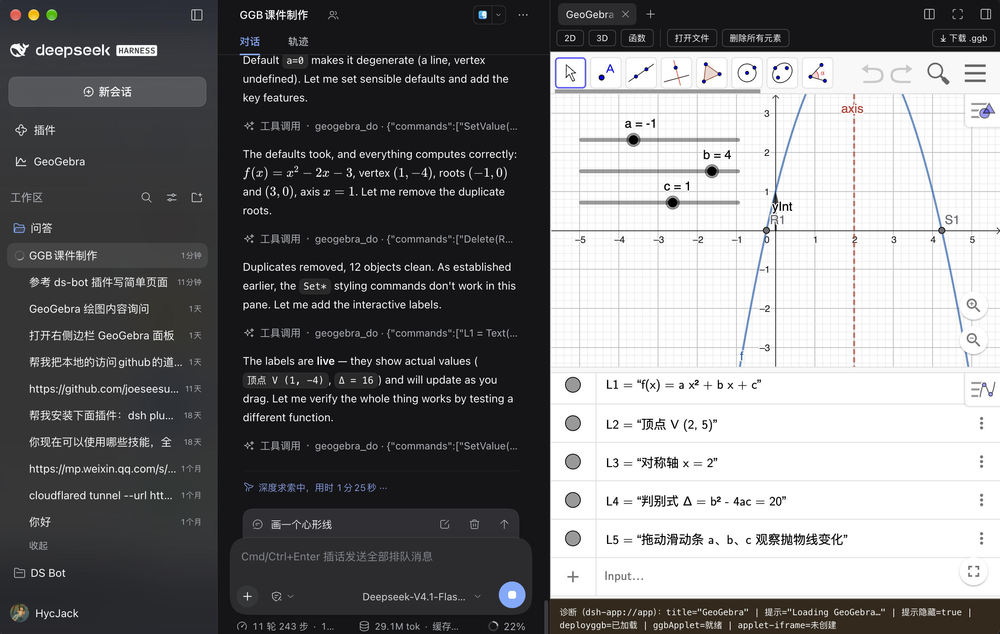

# geogebra-dsh

**把 GeoGebra 嵌进 DSH 的右侧栏，让 AI 和你共用同一块画板。**

在对话里丢一道几何题或函数题，AI 直接在 GeoGebra 里作图 —— 不是贴一张图片。
画完你还能用手拖、用输入栏接着改，AI 也看得到你改了什么。

完全离线，不连 CDN，不依赖你机器上的任何路径。

## 特性

- **面板在右侧栏** —— 原生标签页，不是浮层。从侧边栏图标行那个 GeoGebra 图标点开
- **AI 直接操作真画板** —— 作图、改图、读状态、切视角、导出，7 个工具
- **一次把整张图画完** —— 先读懂题目、把条件翻译成几何关系，整批指令一次提交，出错只重发那几条
- **分得清谁改的** —— 你拖动了一个点，它知道，且只报告你的改动
- **指令发出去之前先校验** —— 内置官方 549 条指令表；拼错的名字当场拦住并给出最接近的那个
- **关掉再打开图还在** —— 图存在宿主侧、按会话分开；切会话不会串到别的画板
- **完全离线** —— GeoGebra 构建随插件分发

## 界面



右侧栏里的 GeoGebra 面板。面板顶部是视图与文件按钮（**2D / 3D / 函数 · 打开文件 · 删除所有元素 · 下载 .ggb**），
下面是 GeoGebra 本体。图中这道题：AB 是直径，C 在圆上，∠CAB = 30° —— `A`、`B`、`O`、`c`、`C`、`tri`、`ang`
全部由 `geogebra_do` 一次调用建立，`ang` 由 GeoGebra 算出 30°。

> 打开方式：侧边栏图标行里的 GeoGebra 图标。也可以不点它 —— 直接问题目，AI 需要时会自己把面板调出来。

## 安装

需要 DSH 桌面端。把插件装进 profile：

```bash
cd ~/.dsh/profiles/desktop
DSH_PREFER_BUNDLED_PNPM=1 ~/.local/bin/pnpm add "file:/path/to/geogebra-dsh"
```

再把它加进 `package.json` 的 `dsh.profile.bundles`：

```json
"bundles": [ ..., "geogebra-dsh" ]
```

然后重启 DSH。

> **宿主半边改了要重启 DSH，客户端半边改了刷新页面即可。**

## 使用

开一个会话直接把题目丢给它就行 —— **不需要先打开面板**，AI 需要时会自己把它调出来。

```
这题怎么做：AB 是⊙O 的直径，C 在圆上，∠CAB = 30°，求证 BC = AB/2
```

也可以明确要求：

```
用 GeoGebra 画一下 y = sin(x) 和 y = x/2 的交点
```

## AI 工具

| 工具 | 作用 |
| --- | --- |
| `geogebra_do` | 执行 GeoGebra 命令，作图或改图（**最常用的一个**） |
| `geogebra_state` | 读当前作图内容：每个对象的定义与当前值，附带诊断 |
| `geogebra_changes` | 读**你手动**做的改动（拖动、输入命令、增删对象） |
| `geogebra_view` | 切换视角：2D / 3D / 函数 / 几何 / 表格 / CAS / 概率 |
| `geogebra_export` | 导出成 `.ggb`（双击即开）或 XML，写到磁盘 |
| `geogebra_check` | 离线校验指令名，对照 549 条官方指令表 |
| `geogebra_params` | 查 GeoGebra App 参数与视角语法（官方取值表） |

## 面板上的按钮

**2D / 3D / 函数** 视图切换 · **打开文件**（载入本地 `.ggb`）· **删除所有元素** · **下载 .ggb**

## 配置

默认用包内的 GeoGebra 构建。想换成别的（更新的版本、或带 `web3d` 的完整树），
在 profile 配置里指定，不用改代码：

```yaml
- id: geogebra-dsh
  config:
    geogebraDir: /path/to/another/GeoGebra
```

## 关于内嵌的 GeoGebra

`vendor/GeoGebra/` 里是 **GeoGebra 5.2.888.1** 的官方构建，约 45 MB，随插件分发。
装了什么、裁掉了什么、为什么裁、怎么加回来，见 [`vendor/README.md`](./vendor/README.md)。

⚠️ **这份代码是 GeoGebra 的，不是本项目的**（© GeoGebra GmbH）。它按 GeoGebra 自己的
条款授权 —— **仅限非商业用途**，并要求署名。完整条款见 [`LICENSE`](./LICENSE)。

因此**本仓库整体只能用于非商业目的**，并且它不是 OSI 意义上的「开源」。
想避开这一点，可以不提交 `vendor/`，改用 `geogebraDir` 指向你本地的构建。

## 开发

```bash
node test/run.mjs      # 零依赖，50 项
```

源码分两半：`src/host/` 是宿主侧（工具、持久化、系统提示词），`lib/client.js` 是浏览器侧
（面板、路由、桥）。改动方式与各项取舍见 `docs/implementation.md`。

## 文档

| 文件 | 看什么 |
| --- | --- |
| [`vendor/README.md`](./vendor/README.md) | 内嵌的 GeoGebra 是哪一版、装了哪些、许可 |
| `docs/implementation.md` | 实现细节：路由、桥、持久化、提示词注入 |
| `docs/dsh-plugin-dev.md` | 在 DSH 里写插件的经验与踩坑 |
| `docs/geogebra.md` | GeoGebra 自身的事实：嵌入、API、哪里静默失败 |

## 许可

- **`vendor/GeoGebra/`** —— GeoGebra 的代码，© GeoGebra GmbH，**仅限非商业用途**，需署名。
  条款原文见 [`LICENSE`](./LICENSE)（取自 <https://www.geogebra.org/license>）。
- **本项目自身的代码**（`src/`、`lib/`、`test/`）—— 许可未指定，可由作者选定。

由于内嵌了 GeoGebra，**本仓库整体只能用于非商业目的**，且不属于 OSI 定义的开源项目。
